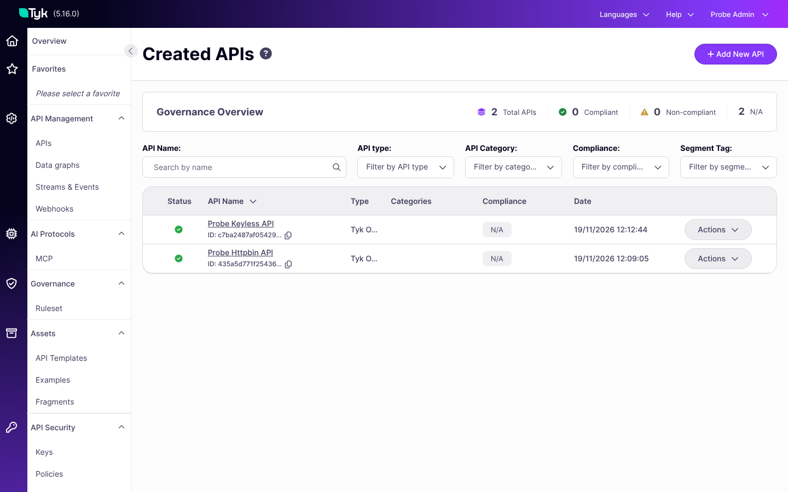

# Cloud sandbox Tyk stack probe

A one-off capability test. It checks if a Claude Code cloud sandbox can run a full Tyk stack, drive each component through its API, and take a Dashboard screenshot with headless Chrome. This folder is temporary. Do not merge it.

## Result

- **Path A (kyt, build from source): partial.** kyt built the Gateway and the Pump from source, and `kyt run-env oss` ran the source-built Gateway (`/hello` returned 200). The Dashboard and MDCB builds failed. They need the private Go modules `TykTechnologies/api-definition` (Dashboard and MDCB) and `TykTechnologies/tyk-sync-internal` (Dashboard), which the sandbox cannot fetch.
- **Path B (released Docker images): worked.** Gateway v5.16.0, Dashboard v5.16.0, MDCB v2.14.0, Pump v1.18.0, Redis 7, PostgreSQL 16 and go-httpbin, started with Docker Compose.

## Checks (Path B)

| Component | Check | HTTP | Result |
| --- | --- | --- | --- |
| Gateway | `GET /hello` | 200 | PASS: `status: pass`, version 5.16.0 |
| Gateway | `GET /tyk/apis` with the Gateway secret | 200 | PASS: empty list before APIs were created |
| Dashboard Admin API | `POST /admin/organisations`, `POST /admin/users` | 200, 200 | PASS: organisation and admin user created, user API key returned |
| Dashboard API | `POST /api/apis/oas` (Tyk OAS, auth token, httpbin upstream) | 200 | PASS: API created |
| Dashboard API | `POST /api/portal/policies` | 200 | PASS: policy created |
| Dashboard API | `POST /api/keys` (key from the policy) | 200 | PASS: key created |
| Gateway data path | `GET /probe/get` with the key | 200 | PASS: proxied to httpbin. Without a key: 401 |
| Pump | Redis to PostgreSQL (SQL and SQL aggregate pumps) | 200 (`/health`) | PASS: `Purged 10 records`. Dashboard `/api/logs` and `/api/usage` show the hits |
| MDCB | `GET :8181/readiness` | 200 | PASS: postgres, redis and gorpc all `pass` |
| MDCB data plane | Worker Gateway over RPC, `GET /hello` | 200 | PASS: `rpc: pass`, APIs and policies synced |
| MDCB data plane | Keyless API through the worker Gateway | 200 | PASS |
| MDCB data plane | Auth-token API through the worker Gateway | 403 | FAIL: `Access to this API has been disallowed` (worker log: `Attempted access with non-existent key`). Not investigated further |
| Headless Chrome | Log in and capture the APIs list | n/a | PASS: Playwright with Chrome for Testing |

Two configuration notes for anyone who repeats this:

- A Tyk OAS API records no analytics until `x-tyk-api-gateway.middleware.global.trafficLogs.enabled` is `true`.
- The Pump exits with `can't connect without connection string` (Mongo uptime pump) unless `dont_purge_uptime_data` is `true` in a PostgreSQL-only setup.

## Timings

| Phase | Time |
| --- | --- |
| kyt build, Gateway (cold Go module cache) | 330 s |
| kyt build, Dashboard UI assets from source (webpack) | about 90 s, then the Go build failed |
| kyt build, all four components | 535 s (2 built, 2 failed) |
| Pull the released images | 54 s |
| Compose up to Dashboard `/hello` 200 | 7 s |
| Bootstrap organisation and user | under 2 s |
| Screenshot | 12 s |

## Screenshot

